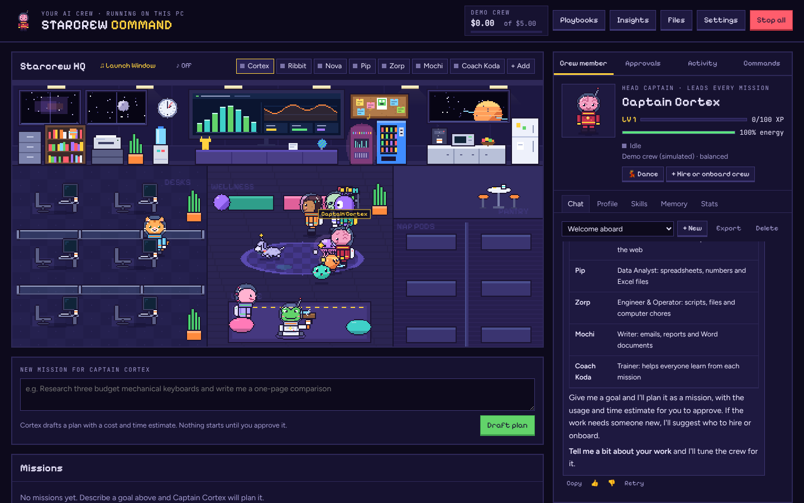
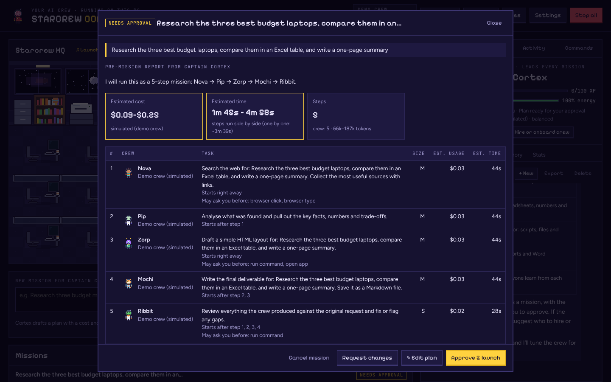
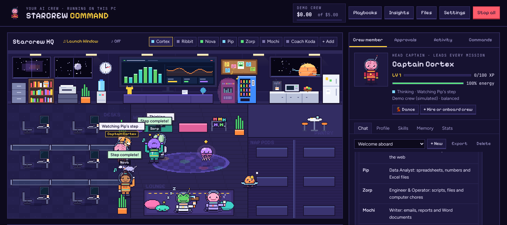
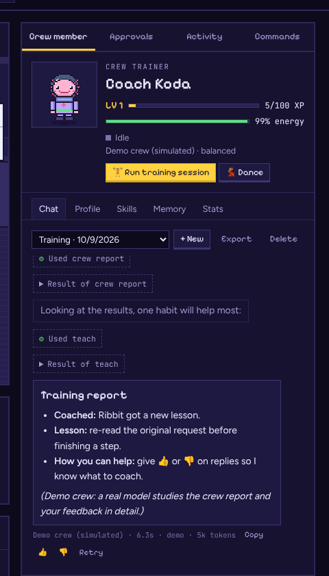
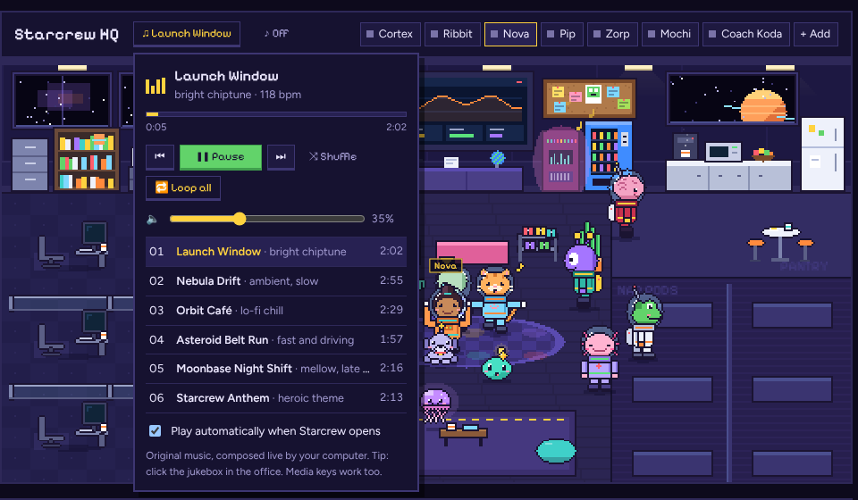
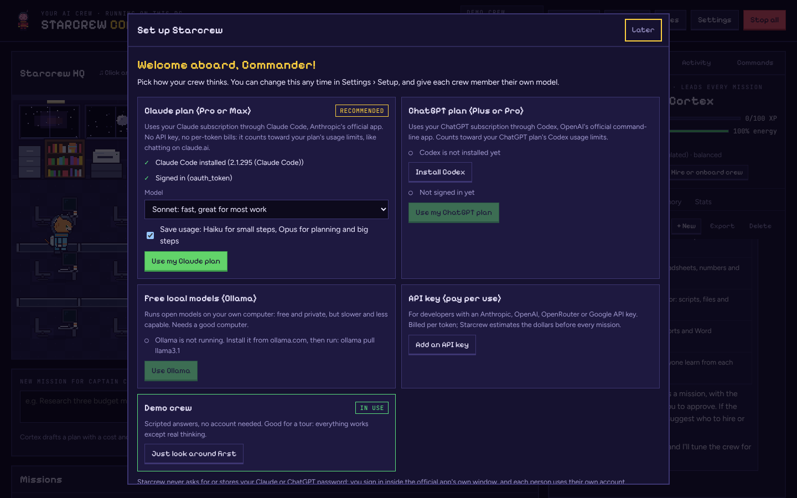

<p align="center">
  
</p>

<h1 align="center">Starcrew Command</h1>

<p align="center"><b>Your own crew of AI agents, living in a pixel-art space office on your computer.</b><br>
Plan missions, see the cost and time before anything starts, and watch the crew work, learn and dance.</p>

<p align="center">
  
  
  
  
</p>

Give **Captain Cortex** a goal. Cortex plans the mission and hands you a **pre-mission report**: the steps, who does
what, which steps run at the same time, the estimated **plan usage or cost**, the estimated time, the risks, and which
actions will ask you first. The crew starts only after you approve. Click anyone to chat with them, check their
skills and lessons, or change their outfit. Works with your **Claude or ChatGPT plan**, an **API key**, free local
models via **Ollama**, or the built-in **demo crew**.

| Pre-mission report | The crew at work |
|---|---|
|  |  |
| **Coach Koda's training session** | **Starcrew radio** |
|  |  |

## Quick start

**Windows**

1. [Download the ZIP](../../archive/refs/heads/main.zip) (or `git clone` this repo) and unzip it somewhere simple, like `C:\Starcrew`.
2. Double-click **`SETUP.bat`**. It installs Node.js if needed, helps you sign in to Claude Code or Codex if you
   want to use your plan, adds a desktop shortcut, and opens Starcrew.
3. Pick how the crew thinks in the setup wizard, then tell Captain Cortex a goal.

**macOS / Linux**

```sh
git clone https://github.com/markjasonesgana/starcrew-command.git
cd starcrew-command
./start.sh --setup     # first time: optional Claude Code / Codex sign-in
./start.sh             # every time after
```

Needs [Node.js 18+](https://nodejs.org). No `npm install` is required; the optional crew browser installs with
`INSTALL-BROWSER.bat` (Windows) or `./start.sh --browser`.

Starcrew opens in your browser at a private one-time link and runs only on `127.0.0.1`. Your keys, chats and the
crew's files stay on your computer in `data/` and `workspace/`.

<p align="center"></p>

## Choosing how the crew thinks

| Option | What you need | How it is paid |
|---|---|---|
| **Claude plan** (recommended) | Claude Pro or Max + Claude Code | your plan's usage limits, no extra bill |
| **ChatGPT plan** | ChatGPT Plus or Pro + Codex | your plan's Codex usage limits |
| **API key** | Anthropic, OpenAI, OpenRouter or Gemini key | per token; Starcrew estimates the dollars |
| **Ollama** | Ollama running on this PC | free, local, slower |
| **Demo crew** | nothing | simulated, for a tour |

### How "use my plan" works (and why it is safe)

Starcrew runs the **official** Claude Code (`claude`) or Codex (`codex`) app that **you** install and
**you** sign in to, with your own account. Starcrew never asks for, sees or stores your Claude or ChatGPT
password or tokens. Their built-in tools are switched off, so the only actions the crew can take are
Starcrew's own checked tools, with the same approvals and limits as everything else.

Good to know:
- Plan usage is shared with your normal chats and has limits that reset over time. Starcrew can't see how
  much is left, so it counts its own requests and stops at a **daily request limit** you choose
  (Settings › Usage & budget). Each crew "turn" (think → act) is one request.
- Each person who runs Starcrew signs in with their **own** account. Don't share one login between people.
- If you run Starcrew for a business, or for other people, use an **API key** instead; consumer plans are meant
  for your own individual use. See Anthropic's and OpenAI's terms.

## Sharing Starcrew

Send people the link to this repo. Everyone runs `SETUP.bat` (or `./start.sh --setup`) and signs in with
**their own** account. If you share a copy of your folder instead, leave out `data/` and `workspace/`:
they hold your keys, chats and files.

## The crew

Starcrew starts with a **default team of seven**. Captain Cortex is the one you talk to first.

| Crew member | Default job | Skills |
|---|---|---|
| **Captain Cortex** | Head Captain: answers quick questions, turns goals into missions, picks who does each step, and builds the crew (hires, creates and onboards agents, assigns skills) | mission planning, crew management, review |
| **Ribbit** | First Officer: the last check on quality and safety before work reaches you | review, security, testing |
| **Nova** | Researcher: finds and compares sources on the web, with links | web research, crew browser |
| **Pip** | Data Analyst: spreadsheets, CSVs, numbers, tidy Excel files | analysis, Office documents, files |
| **Zorp** | Engineer & Operator: scripts, automations, files, commands, opening apps | coding, files, command line, desktop |
| **Mochi** | Writer: emails, reports, summaries, Word documents | writing, Office documents, research |
| **Coach Koda** | Trainer: studies results and your 👍/👎, teaches lessons, tidies memories, proposes new skills | coaching, review |

**Growing the crew.** Ask Cortex ("hire a designer", "we need someone for payroll checks") or use **+ Hire or onboard crew**.
Cortex checks the crew report and fills the gap the cheapest way: give someone a skill, hire from the board, or
create a brand-new agent with its own persona and skills. New members walk into the office and get onboarding
lessons. The hiring board has 8 specialists plus the reserve crew (Gizmo, Inky, Sprig, Rex). When a mission needs
someone the crew lacks, the pre-mission report suggests a hire with a **Hire & re-plan** button.
Crew changes **always** wait for your approval, even on Autopilot, and only you can give the crew-management or coaching skills.

**Training.** Coach Koda runs a training session when you press **🏋 Run training session**, and automatically
after every 5 finished missions (change or turn off in Settings › Safety). Rate replies and missions with 👍/👎;
a 👍 gives XP and a 👎 tells the coach what to work on. Lessons show who taught them in each member's Memory tab.

## Features

- **Missions with estimates.** Plan → pre-mission report → approve → the crew works → final report saved as
  `REPORT.md`. Independent steps run **in parallel** (up to 3 at once by default).
- **Edit the plan.** On the pre-mission report, press **✎ Edit plan** to change who does each step, rewrite tasks,
  reorder, add or remove steps, and choose which steps wait for others. The estimate updates when you save.
- **Resume.** If Starcrew closes mid-mission, the mission is kept as *Interrupted*: press **Resume** and the crew
  continues from the next unfinished step. Failed missions get **Retry the unfinished steps**.
- **Live replies.** Answers type out as they are written (Claude plan, API keys and Ollama; Codex answers arrive whole).
- **Smart routing.** A light model for small steps and reflections, a strong one for planning and big steps.
  With a Claude plan: Haiku for small steps, Opus for plans, Sonnet as the default.
- **Chat with anyone.** Multiple chat threads per crew member, Stop, Retry, Edit your last message (↑),
  attachments (drag and drop, paste or 📎, up to 25 MB), Markdown with tables and code copy buttons,
  per-message usage, inline approvals, suggested prompts, `/new /clear /mission /retry /export`, and
  `@name` to hand a message to another crew member. Export any chat as Markdown.
- **Office files.** The crew reads Excel, Word, PowerPoint and PDF files and creates real `.xlsx` and `.docx` files.
- **Playbooks.** Save a mission and run it again with one click, or on a schedule (hourly, daily, weekdays,
  weekly). Scheduled runs can start on their own only if the estimate stays inside limits you set.
- **Connectors (MCP).** Plug in MCP servers (GitHub, a folder, a database…). Their tools become a skill you can
  give to crew members, and they ask before each call by default.
- **Crew handbook.** Shared notes every crew member reads: your business, your style, your rules.
- **Undo.** Every mission snapshots the workspace first; **↶ Undo file changes** rolls it back.
- **Notifications.** Desktop notifications when a tab is in the background, plus an optional Slack/Discord webhook.
- **Insights.** Plan requests and spend per day, estimate accuracy, and a crew leaderboard.
- **The office.** Crew walk to desks to work, huddle at the lounge table for reviews, dance when done, nap
  when off duty. Lights follow your clock (day and night), with optional sound effects. Click anyone (pets too).
- **Starcrew radio.** Six original space tracks (chiptune, ambient, lo-fi, fast, late-night, anthem), composed live
  by your computer, so there are no music files and nothing copyrighted. Open **♫ Music** above the office for play/pause,
  previous/next, volume, shuffle and the playlist, or click the jukebox in the office. Keyboard media keys work, and
  your volume and track are remembered. The crew dances more when the music is on.
- **They improve.** XP and levels, lessons saved after each step (added to their instructions),
  skill ideas you can adopt, and estimates that calibrate to your crew's history.

## What they can do on your computer

| Tool | What it does | Default (Balanced mode) |
|---|---|---|
| list / read / write files | inside `workspace/` only | automatic |
| read_document, write_spreadsheet, write_document | Excel / Word / PowerPoint / PDF | automatic |
| web_fetch | read a public web page | automatic |
| crew browser | open, read, click, type, screenshot in a separate browser | open/read automatic; **click and type ask you** |
| open_url | open a website in *your* browser | automatic |
| open_app | open an app or a workspace document | **asks you** |
| run_command | PowerShell command in the workspace | **always asks you** |
| connector tools | tools from your MCP connectors | **ask you** (configurable) |

Permission modes per crew member: **Careful**, **Balanced** (default), **Autopilot** (clicks, typing and opening apps run
without asking; terminal commands and crew changes still always ask) or **Read-only**.

## Safety

- Runs only on `127.0.0.1` and opens only through a private one-time link; other websites can't talk to it
  (session cookie, CSRF header and Origin checks, Host check against DNS rebinding, strict Content-Security-Policy).
- API keys and connector secrets are stored in `data/secrets.json` on this PC, never sent to the page,
  and removed from the environment of every command the crew runs.
- Dangerous commands are always blocked: formatting or wiping drives, registry edits, download-and-run,
  encoded PowerShell, user-account changes, scheduled tasks, reading SSH keys or browser data, and more.
- Files can only be read and written inside `workspace/` (symlink escapes included). Uploaded files go to
  `workspace/uploads/`; downloads of non-images are always sent as attachments, never run in the page.
- The crew can't reach `localhost` or your home network, and web content is marked as untrusted so pages
  can't give the crew orders. The crew browser refuses password and payment fields.
- Limits: daily plan requests, daily API dollars, and a cap per mission. When a mission hits its cap it pauses and asks you.
- **Stop all** halts every task, command, connector and the browser at once.
- Everything is logged in **Activity** (and in `data/audit.log`).

## Good to know

- Estimates are ranges, and they get more accurate after a few missions.
- Starcrew must be running for schedules to fire.
- Your data lives in `data/` (crew, missions, chats, settings, keys, undo snapshots). Back it up, or delete it to reset.
- Change the port with the `STARCREW_PORT` environment variable (default 4777).
- If Claude Code or Codex is installed somewhere unusual, set `STARCREW_CLAUDE_BIN` or `STARCREW_CODEX_BIN` to its full path.

## Files

```
SETUP.bat                one-time setup for Windows (Node.js, plan sign-in, browser, desktop shortcut)
START.bat / start.sh     launch Starcrew
INSTALL-BROWSER.bat      optional crew browser (Playwright)
docs/screenshots/        images used in this README
server.js                local server (no third-party packages needed)
lib/                     crew engine, AI providers, plan CLIs, tools, Office files, connectors, safety checks
public/                  the app (office, crew cards, chat, missions, settings)
workspace/               where the crew saves its work (created on first run)
data/                    your crew, missions, chats, settings and keys (created on first run)
```

## Contributing

Issues and pull requests are welcome. Starcrew has no build step: edit the files and restart `node server.js`.
Please keep it dependency-free and keep the safety rules (approvals, sandbox, blocked commands) intact.

## License

[MIT](LICENSE) © 2026 Mark Jason Esgana. Fonts in `public/fonts` are under the SIL Open Font License (see
`public/fonts/LICENSE.txt`). Claude, Claude Code, ChatGPT and Codex are trademarks of their owners; Starcrew is an
independent project and is not affiliated with Anthropic or OpenAI.
